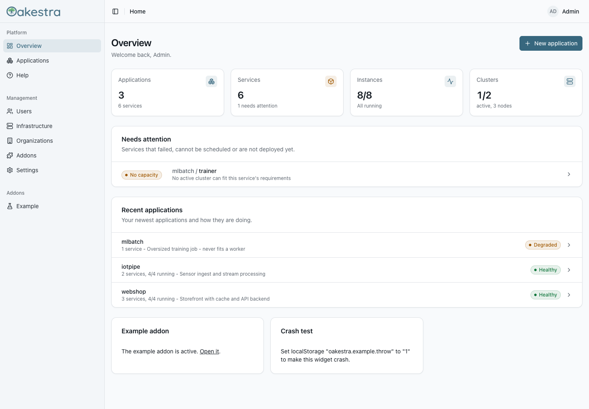
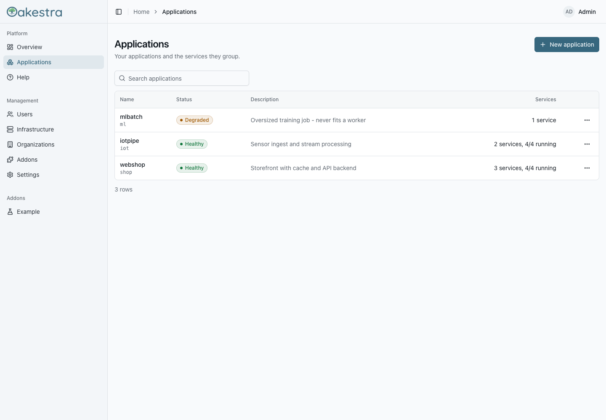
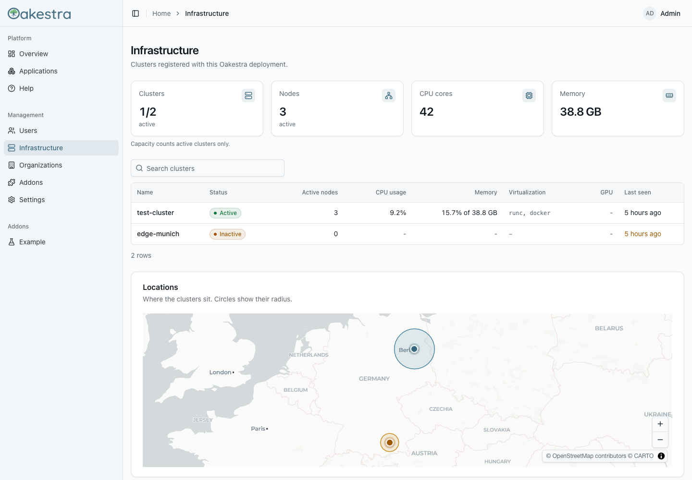
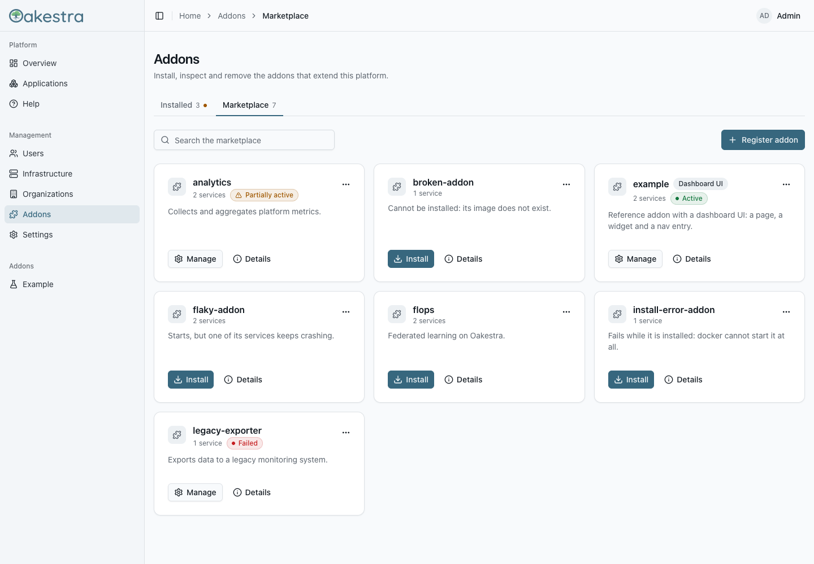
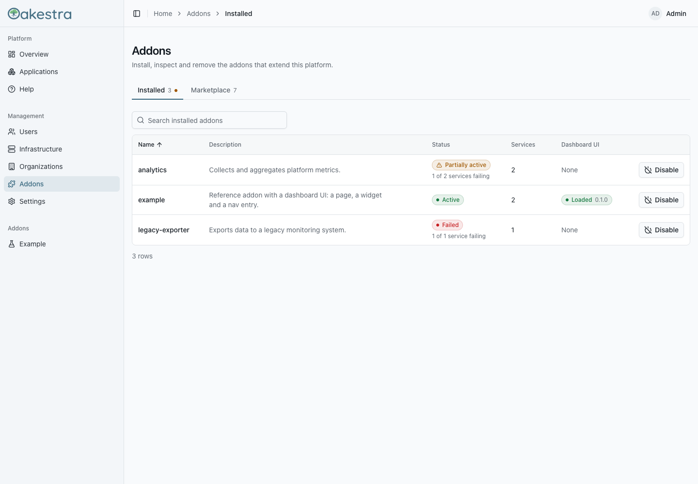
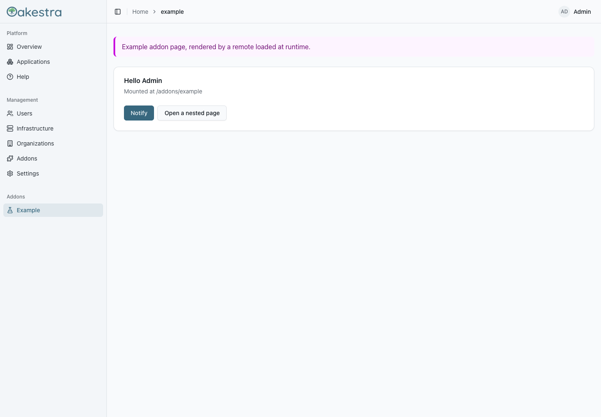
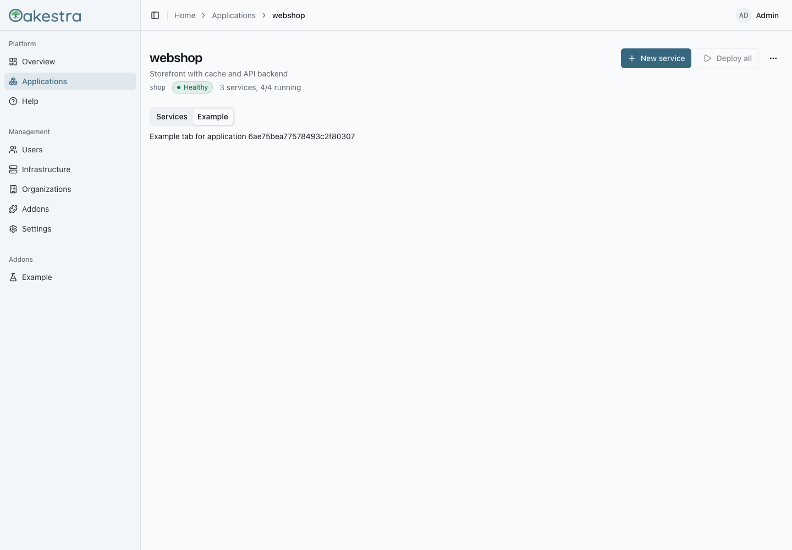
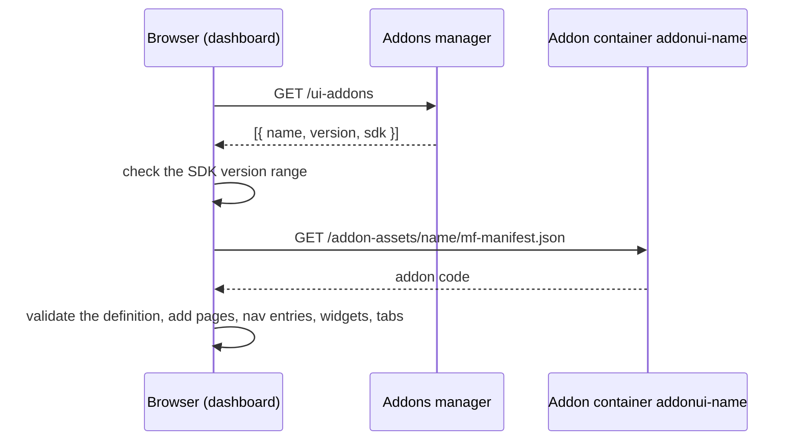

# Oakestra Dashboard

The web dashboard for [Oakestra](https://www.oakestra.io/), the orchestration platform for edge
computing. Deploy and watch applications, manage clusters, users and organizations, and install
addons, all from the browser.

The dashboard is built to be extended: addons ship their own UI, which the dashboard loads at
runtime with [Module Federation](https://module-federation.io/). An addon can add pages, sidebar
entries, widgets and tabs without a new dashboard release.

<picture>
  <source media="(prefers-color-scheme: dark)" srcset="docs/images/overview-dark.png">
  
</picture>

## Contents

- [Features](#features)
- [Screenshots](#screenshots)
- [Quick start](#quick-start)
- [Deployment](#deployment)
- [Addon UIs](#addon-uis)
- [Development](#development)
- [Repository layout](#repository-layout)
- [Documentation](#documentation)

## Features

- **Applications and services**: create, edit and delete applications; create services from an
  SLA form, duplicate and delete them, deploy instances, and follow their status and metrics.
- **Infrastructure**: clusters on a map, with resources and usage history per cluster.
- **Users and organizations**: manage accounts, roles and organization members.
- **Addon manager**: install addons from the marketplace, follow their status and logs, and
  disable or remove them.
- **Addon UIs**: active addons extend the dashboard with their own pages and widgets, loaded at
  runtime from the addon's container.
- **Role-aware UI**: pages, sidebar entries, widgets and tabs adapt to the user's roles (Admin,
  Organization Admin, Application Provider, Infrastructure Provider). Addons can limit their
  contributions to roles too.
- **Light and dark mode**, with accessibility lint rules and checks in Storybook.

## Screenshots

| Applications                                            | Infrastructure                                              |
| ------------------------------------------------------- | ----------------------------------------------------------- |
|       |          |
| **Addon marketplace**                                   | **Installed addons**                                        |
|  |  |
| **A page contributed by an addon**                      | **A tab contributed by an addon**                           |
|        |  |

## Quick start

The fastest way to see the dashboard, including a working addon, is the demo stack. It runs
the dashboard with mock Oakestra backends, so you need nothing but Docker:

```sh
docker compose -f docker-compose.dev.yml up --build -d
```

Open <http://localhost:8080> and log in as `Admin` with the password `Admin`.

[Try the addon demo](docs/demo.md) walks you through it: turn the example addon on and off,
release a new version, break it on purpose and change its code.

### Run from source

You need Node.js 24 and pnpm 12 (`corepack enable` picks the version from `package.json`).

```sh
pnpm install
pnpm dev:mock   # http://localhost:5173, all backends mocked in the browser
```

Log in as `Admin`, `alice`, `bob`, `carol` or `dave`. The password is the username. Each user has
different roles, so you can see how the UI changes per role.

To work against a real Oakestra root orchestrator on `http://localhost:10000`, run `pnpm dev`
instead. Change the API address in
[`apps/shell/public/config.json`](apps/shell/public/config.json).

## Deployment

The dashboard is a static app served by nginx. Release tags publish the image
`ghcr.io/oakestra/dashboard`. The image reads its configuration from environment variables when
the container starts:

| Variable                  | Default                     | Description                                                                 |
| ------------------------- | --------------------------- | --------------------------------------------------------------------------- |
| `API_URL`                 |                             | URL of the system-manager API as the browser sees it, e.g. `https://oakestra.example/api` |
| `API_ADDRESS`             |                             | Alternative to `API_URL`: `host:port` of the system-manager, becomes `http://<API_ADDRESS>/api` |
| `GRAFANA_URL`             |                             | Optional. Adds a Grafana link to the sidebar                                |
| `ADDONS_MANAGER_ADDRESS`  | `root_addons_manager:11101` | Addons manager, reached by nginx (`/ui-addons`, `/addons-api/`)             |
| `MARKETPLACE_ADDRESS`     | `marketplace_manager:11102` | Marketplace manager, reached by nginx (`/marketplace-api/`)                 |
| `ADDONS_POLL_INTERVAL_MS` | `15000`                     | How often the dashboard checks for added or removed addon UIs, in milliseconds (at least `1000`) |
| `DNS_RESOLVER`            | `127.0.0.11`                | DNS server nginx uses for the upstreams above (Docker's by default)         |

Either `API_URL` or `API_ADDRESS` is required. Example:

```sh
docker run -p 8080:80 -e API_ADDRESS=10.0.0.5:10000 ghcr.io/oakestra/dashboard
```

nginx starts even when the addons manager or an addon container is missing; the addon features
then stay empty until they are reachable. Addon UI containers must be named `addonui-<name>` and
be on the same Docker network as the dashboard, see [Packaging an addon](docs/addons/packaging.md).

## Addon UIs

An addon UI is a small React app in its own container. The dashboard asks the addons manager
which addons are active, downloads their code and plugs it into the page:



An addon declares what it adds with `defineAddon` from `@oakestra/dashboard-sdk`:

```tsx
import { defineAddon } from '@oakestra/dashboard-sdk';

export default defineAddon({
  id: 'example',
  routes: [{ index: true, Component: ExamplePage }],
  contributions: {
    'nav.items': [{ id: 'main', label: 'Example', path: '' }],
    'home.widgets': [{ id: 'hello', title: 'Example addon', component: HelloWidget }],
  },
});
```

Start with the [addon developer guide](docs/addons/README.md). The reference addon in
[`addons/example`](addons/example) uses every extension point.

## Development

| Command                                     | What it does                                                   |
| ------------------------------------------- | -------------------------------------------------------------- |
| `pnpm dev`                                  | Shell on <http://localhost:5173> against the API in `apps/shell/public/config.json` |
| `pnpm dev:mock`                             | Shell with all backends mocked in the browser                  |
| `pnpm --filter @oakestra/addon-example dev` | Example addon dev server on <http://localhost:5174>            |
| `pnpm storybook`                            | Storybook of the UI components on <http://localhost:6006>      |
| `pnpm lint`                                 | ESLint (including import boundaries) and Prettier              |
| `pnpm typecheck`                            | TypeScript in every package                                    |
| `pnpm test`                                 | Unit tests (Vitest, with MSW mocks)                            |
| `pnpm build`                                | Production build of every package                              |
| `pnpm e2e`                                  | Playwright suite against the demo stack (start it first)       |
| `pnpm gen:api`                              | Refresh the API types from a running system-manager            |

Before you open a pull request, run:

```sh
pnpm lint && pnpm typecheck && pnpm test && pnpm build
```

Changes to addon loading, nginx, Docker or the SDK also need the end-to-end suite:

```sh
docker compose -f docker-compose.dev.yml up --build -d
pnpm e2e
```

CI runs the same steps on every pull request. Commit messages follow
[Conventional Commits](https://www.conventionalcommits.org/) (`feat: ...`, `fix: ...`).

The shell is React 19, React Router 8, TanStack Query, Tailwind CSS 4 and shadcn/ui components,
built with Vite. [AGENTS.md](AGENTS.md) has the detailed conventions (feature modules, query keys,
mutations, tests, styling, import boundaries). It is written for coding agents but is just as
useful for people.

## Repository layout

```text
apps/shell                  The dashboard (host app)
  src/core                  Platform: config, auth, API client, theme, extension registry, addon runtime
  src/features/<name>       Built-in features: applications, infrastructure, users, addon-manager, ...
packages/dashboard-sdk      The public contract addons build against (@oakestra/dashboard-sdk)
packages/ui                 Shared UI components and Tailwind theme (@oakestra/ui)
packages/api                Typed client for the Oakestra system-manager API (@oakestra/api)
packages/mocks              Mock backends for tests and the demo
addons/example              Reference addon, also used by the e2e suite
tools/mock-addons-manager   Mock addons manager and marketplace for the demo stack
tools/mock-system-manager   Mock system-manager for the demo stack
e2e                         Playwright end-to-end tests
docs                        Documentation
```

## Documentation

- [Try the addon demo](docs/demo.md): run the demo and experiment with addon UIs.
- [Building addon UIs](docs/addons/README.md): concepts and a step-by-step tutorial.
- [SDK reference](docs/addons/reference.md): `defineAddon`, extension points, hooks and components.
- [Packaging an addon](docs/addons/packaging.md): build, container, marketplace entry and versioning.
- [Troubleshooting addons](docs/addons/troubleshooting.md): common problems and how to fix them.
