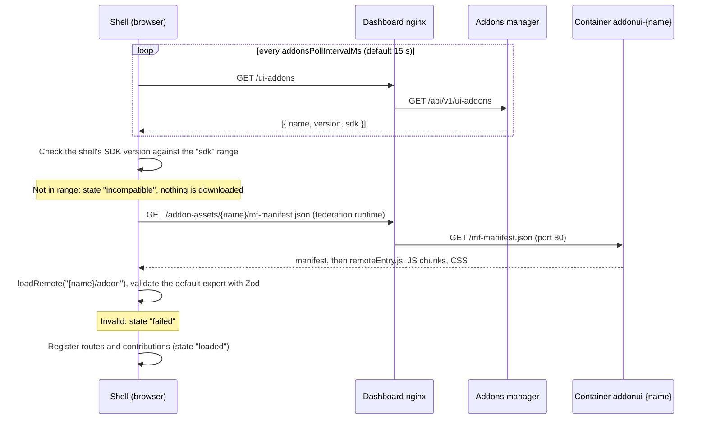

# Building addon UIs

An Oakestra addon can ship its own user interface for the dashboard. This guide shows how to
build one: what an addon UI can do, how the dashboard loads it, and a step-by-step tutorial.

More pages:

- [SDK reference](reference.md): every type, extension point and hook.
- [Packaging and shipping](packaging.md): build setup, styling, the container, versions.
- [Deployment presets](presets.md): choose built-in features, rename sidebar items and ship
  addons with a deployment.
- [Troubleshooting](troubleshooting.md): symptoms, causes and fixes.

## What is an addon UI?

The dashboard is split in two parts:

- The **shell** (`apps/shell`) is the dashboard application itself: login, navigation, the
  built-in pages for applications, services and infrastructure.
- An **addon UI** is a separate JavaScript bundle that the shell downloads at runtime, while the
  dashboard is already running. It is built and deployed on its own, in its own container.

The shell loads addon UIs with **Module Federation**. Module Federation is a way to load code
from another build into a running web application. The application that loads the code is the
**host** (here: the shell). The bundle that is loaded is a **remote** (here: your addon). The
host and the remote agree on a list of **shared singletons**: libraries such as React that must
exist only once on the page. Your addon does not bundle these libraries. It uses the copy the
shell already loaded.

Your addon talks to the shell only through one package, `@oakestra/dashboard-sdk` (the SDK). The
SDK gives you:

- `defineAddon()` to declare your pages and contributions,
- hooks such as `useOakestraApi()` and `useCurrentUser()` to get data and the user,
- the types of all **extension points**.

An **extension point** is a named place in the shell where addons can add UI, for example the
widget grid on the home page. In the shell code, an extension point is rendered by a **slot**
(the `<Slot point="..." />` component). Each item you add to an extension point is a
**contribution**.

## What an addon UI can do

An addon UI can:

- add its own pages, mounted at `/addons/<name>/...`,
- add items to the extension points below,
- call the Oakestra system-manager API as the logged-in user,
- show toast notifications,
- use the dashboard's UI components from `@oakestra/ui`, so it looks like the rest of the
  dashboard.

| Extension point           | What you add                         | Where it shows up                                                                    |
| ------------------------- | ------------------------------------ | ------------------------------------------------------------------------------------ |
| `nav.items`               | A link in the sidebar, optionally with nested sub-items | Sidebar, in the "Addons" group by default ("Platform", "Management" or the bottom of the sidebar on request) |
| `home.widgets`            | A card with a title and your content, or a stat tile or full-width section (`size`) | Overview page (`/`): widget grid at the bottom, summary row or sections above it |
| `application.detail.tabs` | A tab                                | Application page (`/applications/:appId`), next to the "Services" tab                |
| `service.detail.tabs`     | A tab                                | Service page (`/applications/:appId/services/:serviceId`), after "Overview", "Instances", "JSON" |
| `cluster.widgets`         | A card with a title and your content | Cluster page (`/infrastructure/clusters/:clusterId`), at the bottom                  |

Notes:

- The cluster page is only open to users with the `Admin` or `Infrastructure_Provider` role, so
  other users never see `cluster.widgets`.
- The application page shows tabs only when at least one addon contributes a tab. Without
  contributions it shows the service list without tabs.
- Addon pages are only reachable for logged-in users.
- The shell's Settings page is for the dashboard's own settings. An addon puts its settings on
  its own page and links it as a sub-item of its nav entry (see
  [Addon settings](reference.md#addon-settings)).

All details (fields, props, ordering) are in the [reference](reference.md#extension-points).

## How it works at runtime



Step by step:

1. Once someone is logged in, the shell polls `GET /ui-addons` (the login page loads no addon
   code). The answer lists the active addons that ship a UI, as
   `{ name, version, sdk }` entries. The URL and the interval come from the shell's runtime
   `config.json` (`uiAddonsUrl`, default `/ui-addons`; `addonsPollIntervalMs`, default `15000`).
   Entries with an invalid `name` (allowed: `a-z`, `0-9`, `-`) or an invalid semver range in
   `sdk` are ignored with a console warning.
2. For each new addon, the shell checks its own SDK version against the `sdk` range. If it does
   not match, the addon is marked `incompatible` and is not downloaded.
3. The shell registers the addon with the Module Federation runtime, with the manifest URL
   `/addon-assets/<name>/mf-manifest.json`, and loads the module `<name>/addon`.
4. The dashboard's nginx proxies `/addon-assets/<name>/...` to the container `addonui-<name>` on
   port 80. That container is your addon UI image (see [packaging](packaging.md)).
5. The shell validates the module's default export (your `defineAddon({...})` object) with Zod.
   If something is wrong, the addon is marked `failed` with the error message, and the rest of
   the dashboard keeps working.
6. The shell registers your routes and contributions. Nav items, widgets and tabs appear without
   a page reload.

If an addon disappears from `/ui-addons` (disabled or uninstalled), the shell removes its
contributions. If a new version appears while the old one runs, the shell asks the user once to
reload the page. Details are in [packaging](packaging.md#upgrades).

> **Status of the backend:** the `ui` block in the addon definition and the `GET /ui-addons`
> endpoint are planned for the real Oakestra addons-manager and marketplace, but not implemented
> there yet. This repository has a mock that implements them (`tools/mock-addons-manager`). See
> [packaging](packaging.md#the-marketplace-definition-and-ui-addons).

## Tutorial: build your first addon UI

In this tutorial you build an addon called `insights`. It adds:

- a page that lists clusters, and a detail page per cluster,
- a sidebar link,
- a home page widget,
- a tab on the application page,
- a settings page that only administrators can open, linked under the sidebar link.

All code in this tutorial type-checks against the SDK in this repository.

### Prerequisites

- Node.js 24 or newer and pnpm (the repository pins pnpm 12).
- A clone of this repository. Run `pnpm install` once at the root.

Addons currently live inside this monorepo, under `addons/`. The SDK and `@oakestra/ui` are not
published to npm yet. Once they are, an addon can live in its own repository instead (see
[packaging](packaging.md#current-limitation-addons-live-in-this-repository)).

### Step 1: create the addon

```sh
pnpm create:addon insights --prefix ins
```

This creates `addons/insights` from a minimal template (one page, one home widget, a test, the
Dockerfile and a marketplace definition) and runs `pnpm install`, so the lockfile picks up the new
workspace package. Options: `--label <text>` (display name, default `Insights`), `--port <n>`
(default: the next free dev port after the other addons) and `--no-install`. The command refuses
to touch an existing `addons/<name>`, and a prefix that another addon already uses.

### Step 2: what must match

The addon name connects several places. **All of them must use the same name**, otherwise the
shell cannot find or accept your addon. The generator fills them in for you:

| Where                          | Value                                                                   |
| ------------------------------ | ----------------------------------------------------------------------- |
| `vite.config.ts`               | `oakestraAddon({ name: 'insights', prefix: 'ins', port: 5175 })`        |
| `package.json`                 | `@oakestra/addon-insights` (the npm package name, the only one that differs) |
| `Dockerfile`                   | the package name and `addons/insights/...` paths                        |
| `marketplace-definition.json`  | `"name": "insights"` (this becomes the `name` in `/ui-addons`)          |
| The container                  | `addonui-insights`                                                      |
| `index.html`                   | the override hint with the dev port                                     |

Your source files never repeat the name: the `oakestraAddon()` plugin provides it as `ADDON_ID`,
which the template passes to `defineAddon({ id: ADDON_ID })` and `addonQueryKey(ADDON_ID, ...)`:

```ts
import { ADDON_ID } from 'virtual:oakestra-addon';
```

The **prefix** (`ins`) is the other value that must agree: `prefix` in `oakestraAddon(...)`,
`prefix(ins)` in `src/addon.css` and the `ins:` in front of every Tailwind class under `src/`
(`ins:text-sm`). The shell's styles and yours then never collide. The build fails when the two
prefixes differ or a class lacks the prefix. See [styling](packaging.md#styling).

`oakestraAddon()` sets up Module Federation and the dev server the way the shell expects, see
[build configuration](packaging.md#build-configuration).

### Step 3: define the addon

`src/index.tsx` is the module the shell loads (the `entry` of `oakestraAddon()`, this file by
default). Its **default export** must be the result of `defineAddon()`. Replace the
template content with this:

```tsx
// src/index.tsx
import './addon.css';

import { defineAddon } from '@oakestra/dashboard-sdk';
import { ChartLineIcon } from 'lucide-react';
import { ADDON_ID } from 'virtual:oakestra-addon';

import { ActiveClustersWidget } from './contributions/ActiveClustersWidget';
import { ApplicationInsightsTab } from './contributions/ApplicationInsightsTab';
import { ClusterPage } from './pages/ClusterPage';
import { ClustersPage } from './pages/ClustersPage';
import { SettingsPage } from './pages/SettingsPage';

export default defineAddon({
  id: ADDON_ID,
  // Shown as the first breadcrumb of the addon's pages, e.g. "Home > Insights > Cluster".
  label: 'Insights',
  routes: [
    { index: true, Component: ClustersPage },
    { path: 'clusters/:clusterId', crumb: 'Cluster', Component: ClusterPage },
    // Administrators only, see step 6.
    { path: 'settings', crumb: 'Settings', roles: ['Admin'], Component: SettingsPage },
  ],
  contributions: {
    'nav.items': [
      {
        id: 'main',
        label: 'Insights',
        path: '',
        icon: ChartLineIcon,
        // Nested under "Insights" in the sidebar. `roles` only hides the link, see step 6.
        children: [
          { id: 'clusters', label: 'Clusters', path: '' },
          { id: 'settings', label: 'Settings', path: 'settings', roles: ['Admin'] },
        ],
      },
    ],
    'home.widgets': [
      { id: 'active-clusters', title: 'Active clusters', component: ActiveClustersWidget },
    ],
    'application.detail.tabs': [
      { id: 'services', label: 'Insights', component: ApplicationInsightsTab },
    ],
  },
});
```

Keep `import './addon.css';` as the first line. It loads your Tailwind styles together with the
module (see [packaging](packaging.md#styling)).

The next steps create the imported files. Delete the template's `src/pages` and `src/widgets`
files when you no longer need them.

### Step 4: fetch data

Components get the API client with `useOakestraApi()`. It calls the system-manager API with the
logged-in user's token. Use TanStack Query (`@tanstack/react-query`) to fetch: the shell and all
addons share one `QueryClient`.

Because the `QueryClient` is shared, **prefix every query key with your addon id**.
`addonQueryKey(addonId, ...parts)` returns `['addon', addonId, ...parts]`, so your keys never
collide with the shell or with other addons.

```ts
// src/queries.ts
import { addonQueryKey, type OakestraApi } from '@oakestra/dashboard-sdk';
import { queryOptions } from '@tanstack/react-query';
import { ADDON_ID } from 'virtual:oakestra-addon';

// The element type of api.clusters.list(), without a dependency on @oakestra/api.
export type Cluster = Awaited<ReturnType<OakestraApi['clusters']['list']>>[number];

export const insightsKeys = {
  clusters: () => addonQueryKey(ADDON_ID, 'clusters'),
  activeClusters: () => addonQueryKey(ADDON_ID, 'clusters', 'active'),
  services: (applicationId: string) => addonQueryKey(ADDON_ID, 'services', applicationId),
};

export const clustersQuery = (api: OakestraApi) =>
  queryOptions({
    queryKey: insightsKeys.clusters(),
    queryFn: ({ signal }) => api.clusters.list({ signal }),
  });
```

Pass `signal` to the API call. TanStack Query then cancels requests that are no longer needed.

### Step 5: add a page and show a toast

Routes are relative to the addon's base path `/addons/insights`. The index route
(`{ index: true }`) is `/addons/insights`, `clusters/:clusterId` is
`/addons/insights/clusters/<id>`. Build links with `useAddonPath()`, never hard-code
`/addons/insights`: `addonPath('clusters', id)` returns `/addons/insights/clusters/<id>` with the id
URI-encoded, `addonPath()` the base path.

The breadcrumbs above the page show the addon's `label` followed by the `crumb` of the matched
route: `Home > Insights` here, `Home > Insights > Cluster` on the detail page.

`useNotify()` shows a toast. This page lists the clusters in a `DataTable` and shows a toast after
a manual refresh:

```tsx
// src/pages/ClustersPage.tsx
import { useAddonPath, useNotify, useOakestraApi } from '@oakestra/dashboard-sdk';
import { Button, EmptyState, PageHeader, StatusBadge } from '@oakestra/ui';
import { createDataTableColumnHelper, DataTable } from '@oakestra/ui/data-table';
import { useQuery } from '@tanstack/react-query';
import { RefreshCwIcon } from 'lucide-react';
import { useNavigate } from 'react-router';

import { clustersQuery, type Cluster } from '../queries';

const column = createDataTableColumnHelper<Cluster>();

const columns = column.columns([
  column.accessor('cluster_name', { header: 'Name' }),
  column.accessor('active', {
    header: 'Status',
    cell: (info) =>
      info.getValue() ? (
        <StatusBadge tone="success">Active</StatusBadge>
      ) : (
        <StatusBadge tone="neutral">Inactive</StatusBadge>
      ),
  }),
  column.accessor((cluster) => cluster.active_nodes ?? 0, {
    id: 'active_nodes',
    header: 'Active nodes',
    meta: { numeric: true },
  }),
]);

export function ClustersPage() {
  const api = useOakestraApi();
  const notify = useNotify();
  const addonPath = useAddonPath();
  const navigate = useNavigate();
  const clusters = useQuery(clustersQuery(api));

  const refresh = async () => {
    const result = await clusters.refetch();
    if (result.isSuccess) notify.success('Cluster list refreshed');
  };

  if (clusters.isError) {
    return (
      <EmptyState
        title="Could not load the clusters"
        description={clusters.error.message}
        action={<Button onClick={() => void clusters.refetch()}>Try again</Button>}
      />
    );
  }

  return (
    <div className="ins:space-y-6">
      <PageHeader
        title="Insights"
        description="Clusters known to this Oakestra root orchestrator."
        actions={
          <Button variant="outline" onClick={() => void refresh()}>
            <RefreshCwIcon aria-hidden /> Refresh
          </Button>
        }
      />
      <DataTable
        label="Clusters"
        columns={columns}
        data={clusters.data}
        isLoading={clusters.isPending}
        getRowId={(cluster) => cluster._id}
        onRowClick={(cluster) => void navigate(addonPath('clusters', cluster._id))}
      />
    </div>
  );
}
```

`DataTable` comes from the subpath `@oakestra/ui/data-table`, not from the package root. Large
components live in subpaths so that pages which do not use them do not download them (see the
[reference](reference.md#oakestraui)).

API errors have a readable `message`, so `error.message` can go straight into the UI. For errors
of unknown origin, `describeError(error)` from the SDK returns a sentence in every case.

### Step 6: add a nested page and restrict by role

The detail page reads the route parameter with `useParams()` from `react-router`. It shows a link
to the shell's own cluster page, but only to users who are allowed to open that page:

```tsx
// src/pages/ClusterPage.tsx
import { useAddonPath, useOakestraApi, usePermissions } from '@oakestra/dashboard-sdk';
import { Button, PageHeader, SectionCard, Skeleton } from '@oakestra/ui';
import { useQuery } from '@tanstack/react-query';
import { Link, useParams } from 'react-router';

import { clustersQuery } from '../queries';

export function ClusterPage() {
  const { clusterId } = useParams();
  const api = useOakestraApi();
  const addonPath = useAddonPath();
  const permissions = usePermissions();
  // Same query as the list page, so this usually renders from the cache.
  const clusters = useQuery(clustersQuery(api));
  const cluster = clusters.data?.find((item) => item._id === clusterId);

  if (clusters.isPending) return <Skeleton className="ins:h-40 ins:w-full" />;
  if (clusters.isError) return <p className="ins:text-destructive">{clusters.error.message}</p>;
  if (!cluster) return <p>Cluster {clusterId} was not found.</p>;

  return (
    <div className="ins:space-y-6">
      <PageHeader
        title={cluster.cluster_name}
        actions={
          <Button asChild variant="outline">
            <Link to={addonPath()}>Back</Link>
          </Button>
        }
      />
      <SectionCard title="Details">
        <p className="ins:text-sm">Active nodes: {cluster.active_nodes ?? 0}</p>
        {/* The shell's cluster page is only open to these roles. */}
        {permissions.hasAnyRole(['Admin', 'Infrastructure_Provider']) ? (
          <Link className="ins:text-sm ins:underline" to={`/infrastructure/clusters/${cluster._id}`}>
            Open in Infrastructure
          </Link>
        ) : null}
      </SectionCard>
    </div>
  );
}
```

There are four ways to restrict by role:

| Tool                                  | Effect                                                                                      |
| ------------------------------------- | ------------------------------------------------------------------------------------------- |
| `roles: [...]` on a contribution      | The shell hides the nav item, sub-item, widget or tab from users without a role in the list |
| `roles: [...]` on a route             | The shell shows its "Access denied" page instead of the route and its children              |
| `visible: (context, user) => boolean` | Extra check for widgets and tabs, with the slot context and the user                        |
| `usePermissions()` inside a component | Your own checks, for example inside a page                                                  |

`roles` on a nav item only hides the link. Any logged-in user who types the URL still
reaches the page, unless the route has `roles` too. The backend enforces permissions either way: the API
answers with the user's own permissions.

The "Settings" sub-item from step 3 has `roles: ['Admin']`, so other users do not see the link,
and its route has the same `roles`, so they cannot open the page either. The page itself needs no
check:

```tsx
// src/pages/SettingsPage.tsx
import { PageHeader, SectionCard } from '@oakestra/ui';

export function SettingsPage() {
  return (
    <div className="ins:space-y-6">
      <PageHeader title="Insights settings" />
      <SectionCard title="General">
        <p className="ins:text-sm">The insights addon has no settings yet.</p>
      </SectionCard>
    </div>
  );
}
```

### Step 7: add a home widget

A widget is a component. The shell puts it in a card and renders your `title` as the card
title. Keep widgets small; link to your page for details. With `size: 'stat'` it becomes a tile in
the summary row at the top of the overview instead, and with `size: 'wide'` a full-width section;
both draw their own frame (see [widget sizes](reference.md#widget-sizes-on-the-overview)).

```tsx
// src/contributions/ActiveClustersWidget.tsx
import { useAddonBasePath, useOakestraApi } from '@oakestra/dashboard-sdk';
import { useQuery } from '@tanstack/react-query';
import { Link } from 'react-router';

import { insightsKeys } from '../queries';

export function ActiveClustersWidget() {
  const api = useOakestraApi();
  const basePath = useAddonBasePath();
  const active = useQuery({
    queryKey: insightsKeys.activeClusters(),
    queryFn: ({ signal }) => api.clusters.listActive({ signal }),
  });

  if (active.isPending) return <p className="ins:text-muted-foreground ins:text-sm">Loading...</p>;
  if (active.isError) return <p className="ins:text-destructive ins:text-sm">{active.error.message}</p>;
  return (
    <p className="ins:text-sm">
      <span className="ins:text-2xl ins:font-semibold ins:tabular-nums">{active.data.length}</span> clusters
      reported in recently.{' '}
      <Link className="ins:underline" to={basePath}>
        Details
      </Link>
    </p>
  );
}
```

`useAddonBasePath()` works in widgets and tabs too: the shell tells every addon component which
addon it belongs to.

### Step 8: add an application tab

Tabs and some widgets get **context props** from the slot. An application tab receives
`{ applicationId }` (type `ApplicationContext`):

```tsx
// src/contributions/ApplicationInsightsTab.tsx
import { useOakestraApi, type ApplicationContext } from '@oakestra/dashboard-sdk';
import { useQuery } from '@tanstack/react-query';

import { insightsKeys } from '../queries';

export function ApplicationInsightsTab({ applicationId }: ApplicationContext) {
  const api = useOakestraApi();
  const services = useQuery({
    queryKey: insightsKeys.services(applicationId),
    queryFn: ({ signal }) => api.services.listForApplication(applicationId, { signal }),
  });

  if (services.isPending) return <p className="ins:text-sm">Loading...</p>;
  if (services.isError) return <p className="ins:text-destructive ins:text-sm">{services.error.message}</p>;
  return (
    <ul className="ins:list-inside ins:list-disc ins:text-sm">
      {services.data.map((service) => (
        <li key={service._id}>
          {service.microservice_name}: {service.instance_list.length} instance(s)
        </li>
      ))}
    </ul>
  );
}
```

TypeScript checks the props: a component that expects `{ clusterId }` is rejected for an
application tab.

### Step 9: run it locally with the dev override

You do not need Docker or an addons manager to develop. A development build of the shell can load
an addon straight from its Vite dev server. This is the **dev override**.

1. Start your addon's dev server:

   ```sh
   pnpm --filter @oakestra/addon-insights dev
   ```

   It serves `http://localhost:5175/mf-manifest.json`.

2. Start the shell in a second terminal. Pick one:

   - `pnpm dev:mock` needs no backend at all. A mock API runs in the browser. Log in as `Admin`
     (password `Admin`), or as `alice`, `bob`, `carol` or `dave` (password = username) to check
     role-dependent UI.
   - `pnpm dev` talks to a real system-manager at `http://localhost:10000/api` (from
     `apps/shell/public/config.json`).

3. Open the shell with the override parameter:

   ```text
   http://localhost:5173/?addon-override=insights=http://localhost:5175/mf-manifest.json
   ```

The override is stored in `localStorage` (key `oakestra.addon-overrides`), so it survives reloads.
Remove it with an empty URL: `?addon-override=insights=`. An addon that only exists as an override
gets version `0.0.0-dev` and SDK range `*`.

Edit your code and reload the browser page to see changes. The override only works in development
builds of the shell (`pnpm dev`, `pnpm dev:mock`). Production images ignore it.

To check type errors and lint:

```sh
pnpm --filter @oakestra/addon-insights typecheck
pnpm lint
```

### Step 10: build the container

From the repository root:

```sh
docker build -f addons/insights/Dockerfile -t addon-insights-ui .
```

The image is nginx serving the built files on port 80. To be loaded by the dashboard, it must run
as a container named `addonui-insights` on a Docker network the dashboard container can reach,
and the addons manager must list it in `/ui-addons`. [Packaging](packaging.md) explains the full
contract, the marketplace definition and how to test the production build locally.

## Rules of thumb

- Import only `@oakestra/dashboard-sdk`, `@oakestra/ui` (root or the subpaths `/chart`,
  `/data-table`, `/command`, `/map`), and types from `@oakestra/api`. Lint enforces this.
- Never bundle your own React, React Router, TanStack Query or SDK. The build config already
  takes them from the shell.
- Prefix every query key with `addonQueryKey(ADDON_ID, ...)`.
- Build links with `useAddonPath()` (or from `useAddonBasePath()`), never hard-code
  `/addons/<id>`.
- Put `roles` on the route, not only on its nav item, for pages limited to some roles.
- Do not import full Tailwind or `@oakestra/ui/styles.css` in your addon. Use the `addon.css` from
  the example with your own prefix, and prefix every class (`ex:flex`), see
  [styling](packaging.md#styling).
- Addon code is public: anyone who can reach the dashboard can download it from
  `/addon-assets/<name>/`, even before logging in. Never put secrets in it.
