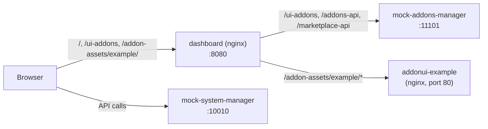

# Try the addon demo

The demo runs the dashboard with mock backends, so you can see how addon UIs work: look at the
example addon, turn it off and on, break it, upgrade it and change its code. You do not need a
real Oakestra cluster for any of this.

There are two ways to run the demo:

| Setup                                   | Needs               | Good for                                                |
| --------------------------------------- | ------------------- | ------------------------------------------------------- |
| [Docker stack](#1-run-the-docker-stack) | Docker              | The real thing: addon loaded from its own container     |
| [No Docker](#2-run-without-docker)      | Node.js 24, pnpm 12 | Changing the example addon's code and seeing the result |

## What you will see

The dashboard (we call it the **shell**) has no addon code built in. When the page loads, the
shell asks the addons manager which addons are active (`GET /ui-addons`). For each addon with a
UI, it downloads the addon's code from the addon's own container and plugs it into the page. This
is done with [Module Federation](https://module-federation.io/): the addon is a **remote**, the
shell is the **host**.

The example addon in [`addons/example`](../addons/example) adds something to every place where
addons can contribute (an **extension point**):

| Extension point           | Where it shows up                                                                                                        |
| ------------------------- | ------------------------------------------------------------------------------------------------------------------------ |
| `nav.items`               | "Example" entry in the sidebar, under Addons, with the sub-items "Overview", "Settings" (Admins only) and "About"        |
| routes                    | Its own pages at `/addons/example`, `/addons/example/about`, `/addons/example/settings` and `/addons/example/details/42` |
| `home.widgets`            | "Example addon" and "Crash test" cards on the Overview page                                                              |
| `application.detail.tabs` | "Example" tab on an application's detail page                                                                            |
| `service.detail.tabs`     | "Example" tab on a service's detail page                                                                                 |
| `cluster.widgets`         | "Example" card on a cluster's detail page                                                                                |

## 1. Run the Docker stack

This starts the production images of the shell and the example addon, wired up like a real
deployment. Two small Node servers stand in for the Oakestra backends:

- **mock system-manager** (port 10010): the Oakestra API with sample applications, clusters and
  users.
- **mock addons manager** (port 11101): the addons manager and the marketplace. It also has a
  small `/__test` API that we use below to change addons from the command line.

```sh
docker compose -f compose.dev.yml up --build -d
```

Open <http://localhost:8080> and log in as `Admin` with the password `Admin`.



If a port is already taken, change it with the variables `DASHBOARD_PORT`, `MOCK_API_PORT` and
`MOCK_ADDONS_MANAGER_PORT`. The commands below assume the default ports.

Stop the stack when you are done:

```sh
docker compose -f compose.dev.yml down
```

### Look around

1. The sidebar has an **Example** entry under **Addons**. Click it. The fuchsia banner and the
   greeting come from the addon. Click **Notify** to show a toast through the shell, and **Open a
   nested page** to see a second addon route. The entry expands into the sub-items **Overview**,
   **Settings** and **About**, which the addon declares as `children` of its nav item. The
   addon's settings live on its own page; **Settings** at the bottom of the sidebar is only for
   the dashboard itself. The breadcrumbs follow the addon's pages: **Home > Example > About** on
   the About page, with the addon's label and the crumbs its routes declare.
2. Go to **Overview**. The **Example addon** and **Crash test** cards are addon widgets.
3. Open **Applications**, pick an application and select the **Example** tab. The addon receives
   the application id from the shell.
4. Open **Addons > Installed**. The **Dashboard UI** column shows the state of each addon's UI
   (for example "Loaded 0.1.0", "Incompatible" or "None" for addons without a UI).

### Experiment 1: Turn the addon off and on

In the dashboard: **Addons > Installed**, open `example`, click **Disable addon** and confirm.
The nav entry, the widgets and the tabs disappear without a page reload. To get it back, first
**Remove** the disabled addon in **Addons > Installed**, then install it again from **Addons >
Marketplace**.

You can do the same from a terminal, as if the backend changed on its own:

```sh
# Turn it off
curl -X PUT http://localhost:11101/__test/addons/example \
  -H 'Content-Type: application/json' -d '{"enabled": false}'

# Turn it on again
curl -X PUT http://localhost:11101/__test/addons/example \
  -H 'Content-Type: application/json' -d '{"enabled": true}'
```

The shell polls `/ui-addons` every second in this stack (every 15 seconds by default), so the
page follows within a moment. If you are on `/addons/example` while the addon is off, the shell
shows a "disabled" page instead of an error.

### Experiment 2: Release a new version

```sh
curl -X PUT http://localhost:11101/__test/addons/example \
  -H 'Content-Type: application/json' -d '{"version": "0.2.0"}'
```

A toast says "A new version of example is available". The running addon keeps working: code that
is already loaded into a page cannot be swapped out safely, so the shell asks the user to reload.
Click **Reload** to load the new version.

### Experiment 3: Build against an SDK the shell does not have

Every addon says which versions of the dashboard SDK it works with, as a semver range. The shell
checks that range before it downloads any addon code.

```sh
curl -X PUT http://localhost:11101/__test/addons/example \
  -H 'Content-Type: application/json' -d '{"sdk": "^9.0.0"}'
```

Reload the page. The example addon is gone from the sidebar, `/addons/example` explains that the
addon needs SDK `^9.0.0`, and **Addons > Installed** shows it as incompatible. Set it back with
`-d '{"sdk": "^0.1.0"}'` and reload.

### Experiment 4: An addon whose UI cannot be reached

Install an addon whose UI container does not exist:

```sh
curl -X PUT http://localhost:11101/__test/addons/ghost \
  -H 'Content-Type: application/json' -d '{"enabled": true}'
```

Open <http://localhost:8080/addons/ghost>. The shell shows that `ghost` failed to load and keeps
retrying in the background. Everything else, including the example addon, keeps working.

### Experiment 5: A widget that crashes

Every contribution runs inside its own error boundary, so one broken widget cannot take the page
down. The example's **Crash test** widget throws on purpose when a flag is set. Open the browser
console on the dashboard and run:

```js
localStorage.setItem('oakestra.example.throw', '1');
```

Reload the Overview page. Only the **Crash test** card shows an error. Remove the flag with
`localStorage.removeItem('oakestra.example.throw')`.

### Experiment 6: Roles

Contributions can be limited to roles. The example's **Settings** sub-item is for `Admin` only.
Log out and log in as `alice` (password `alice`, an Application Provider): the **Settings**
sub-item under **Example** is gone, and so is the Admin-only **Addons** entry in the sidebar. The
**Example** entry and its other sub-items stay, because they have no role limit. Open
`/addons/example/settings` by hand: the shell shows its **Access denied** page, because the
addon also put `roles: ['Admin']` on the settings route. `roles` on a nav item only hides the
link.

| User    | Password | Roles                                    |
| ------- | -------- | ---------------------------------------- |
| `Admin` | `Admin`  | all four roles, including Admin          |
| `alice` | `alice`  | Application_Provider                     |
| `bob`   | `bob`    | Infrastructure_Provider                  |
| `carol` | `carol`  | Organization_Admin, Application_Provider |
| `dave`  | `dave`   | Application_Provider                     |

### Experiment 7: Installs that fail later

In **Addons > Marketplace**, install `flaky-addon` or `broken-addon`. They first become `active`
and a few seconds later turn `partially_active` or `failed`. The detail sheet lists the failed
services, and for `broken-addon` also the logs. This
is how the real addons monitor behaves: it notices crashed containers only on a later check.
`install-error-addon` fails right away. These addons have no UI; they show the management side.

### Start over

```sh
curl -X POST http://localhost:11101/__test/reset
```

This restores the original addons. More test endpoints are listed in the
[mock addons manager](../tools/mock-addons-manager/src/app.ts).

## 2. Run without Docker

This setup runs the shell and the example addon as Vite dev servers on your machine. The shell
uses [MSW](https://mswjs.io/) to answer all API calls inside the browser, so no backend is
needed.

You need Node.js 24 and pnpm 12 (`corepack enable` sets up the version from `package.json`).

```sh
pnpm install

# Terminal 1: the shell with mocked backends, on http://localhost:5173
pnpm dev:mock

# Terminal 2: the example addon's dev server, on http://localhost:5174
pnpm --filter @oakestra/addon-example dev
```

In this mode `/ui-addons` returns an empty list, because there is no addon container. Tell the
shell to load the example addon from your dev server instead, with the **dev override** in the
URL:

<http://localhost:5173/?addon-override=example=http://localhost:5174/mf-manifest.json>

Log in as `Admin` / `Admin`. The example addon now appears exactly as in the Docker stack.

The override is saved in `localStorage`, so it stays when you navigate or reload. Remove it with
an empty URL: `?addon-override=example=`. It only exists in development builds; the production
image ignores it.

### Change the addon

Open [`addons/example/src/pages/ExamplePage.tsx`](../addons/example/src/pages/ExamplePage.tsx)
and change the banner text, then reload the dashboard. Some ideas to try:

- Add a second widget to `home.widgets` in
  [`addons/example/src/index.tsx`](../addons/example/src/index.tsx) and give it `order: 0` to put
  it first.
- Add `roles: ['Admin']` to the nav item and log in as `alice`.
- Load real data in the page with `useOakestraApi()` and TanStack Query, for example
  `api.applications` or `api.clusters`.
- Return something that is not a valid definition, for example a nav item with
  `path: '/absolute'`. The shell rejects the addon, and **Addons > Installed** shows why in the
  section for dashboard UIs without an installed addon (a dev override has no installed record).

The [addon developer guide](addons/README.md) explains each of these in detail.

## Troubleshooting the demo

- **Port already in use.** Something else runs on 5173, 5174, 8080, 10010 or 11101. Stop it, or
  for the Docker stack set the port variables shown above. An old Vite server on 5173 can serve a
  stale build: stop it before you run `pnpm dev:mock`.
- **No "Example" entry in the Docker stack.** Check that all four containers run
  (`docker compose -f compose.dev.yml ps`) and reset the mock with
  `curl -X POST http://localhost:11101/__test/reset`.
- **No "Example" entry without Docker.** Check that the addon dev server runs on port 5174 and
  that the URL contains the override. The browser console shows `[addons]` messages when loading
  fails.
- **The map on the Infrastructure page is empty.** The map tiles come from the internet and need
  WebGL2.

More help for addon problems: [addon troubleshooting](addons/troubleshooting.md).
